# DevOps Project — Verification & Architecture Artifacts

**Repository:** [mr-panther01/final-project-devops](https://github.com/mr-panther01/final-project-devops)  
**Project:** TaskBoard Cloud — Microservices Task Management Architecture  

---

## Module 1: Application — Frontend + Backend + Database

### Architecture & Features:
- FastAPI backend starts and responds to `/health` and `/ready` endpoints.
- Full REST API with endpoints (`GET`, `POST`, `PUT`, `DELETE`, `/stats`).
- PostgreSQL database with schema migrations managed by Alembic (`backend/alembic/versions/`).
- Responsive, modern React + Vite frontend dashboard rendering tasks, KPI metrics, and modal dialogs.

### Visual Verification:
> **Application Running in Browser:** Shows the live SaaS TaskBoard dashboard with responsive navigation, stats cards, and interactive task table.

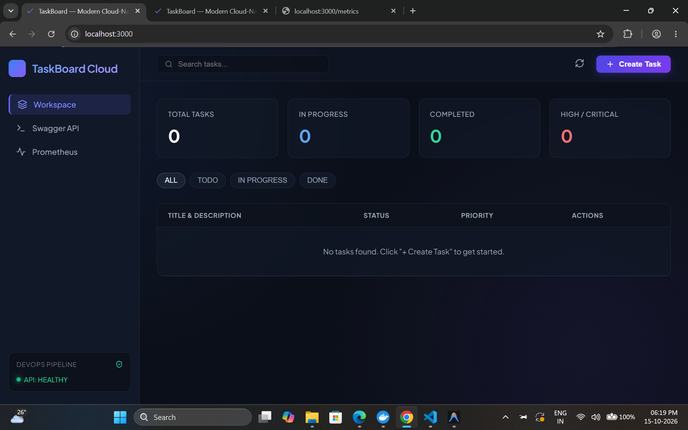

---

## Module 2: Testing — Pytest + Code Quality

### Architecture & Features:
- Automated test suite runs with Pytest across all core endpoints.
- Comprehensive test cases covering CRUD workflows, health check, ready check, metrics, and error validation (422 validation and 404 handling).
- Isolated SQLite in-memory test database fixture via `backend/tests/conftest.py` ensuring production database is untouched.
- Configured via `backend/pytest.ini`.

### Visual Verification:
> **Pytest Suite Terminal Execution:** All unit tests executed with `-v` flag showing all test cases passing cleanly with zero failures.

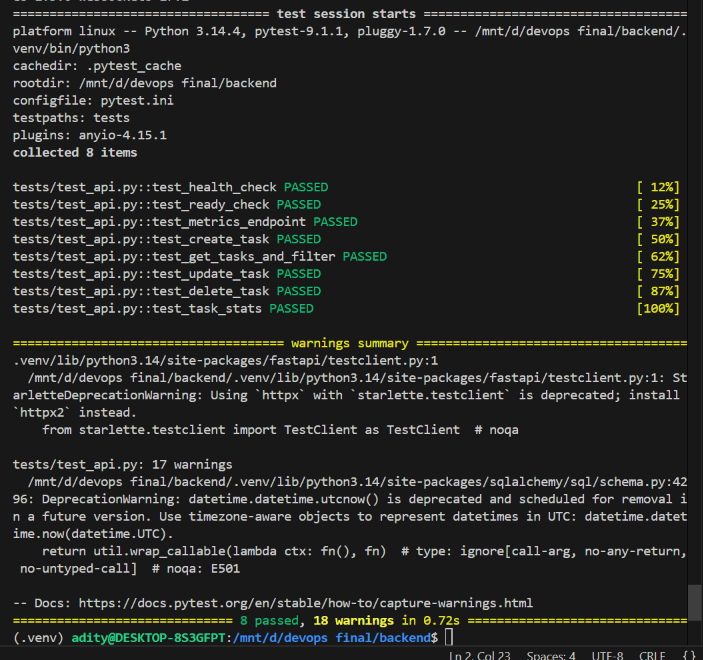

---

## Module 3: Git and GitHub

### Architecture & Features:
- Public GitHub repository with active branch management.
- Meaningful, conventional commit messages adhering to professional engineering standards (e.g., `feat:`, `fix:`, `test:`, `docs:`, `ci:`).
- Robust `.gitignore` strictly excluding `.env`, `__pycache__`, `node_modules`, `.venv`, and `*.tfstate`.

### Visual Verification:
> **Commit History:** Linear Git log showing meaningful, conventional commits across all project milestones.

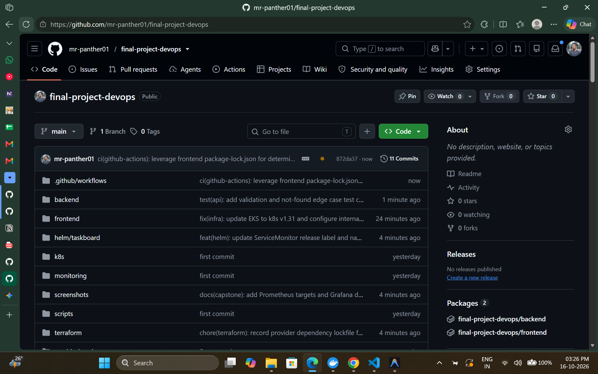

---

## Module 4: Docker — Dockerfile + Compose

### Architecture & Features:
- `backend/Dockerfile`: Multi-stage build starting from Python 3.12-slim, non-root user (`appuser:10001`), database migrations executed at startup.
- `frontend/Dockerfile`: Multi-stage build (Node 20 Alpine builder + unprivileged Nginx runtime) running as non-root.
- `docker-compose.yml`: Defines `postgres`, `backend`, and `frontend` services with healthchecks and isolated bridge network.
- Single command deployment: `docker compose up --build`.

### Visual Verification:
> **Docker Compose Build & Startup:** Terminal output showing all three containers starting, passing healthchecks, and listening on their respective ports.

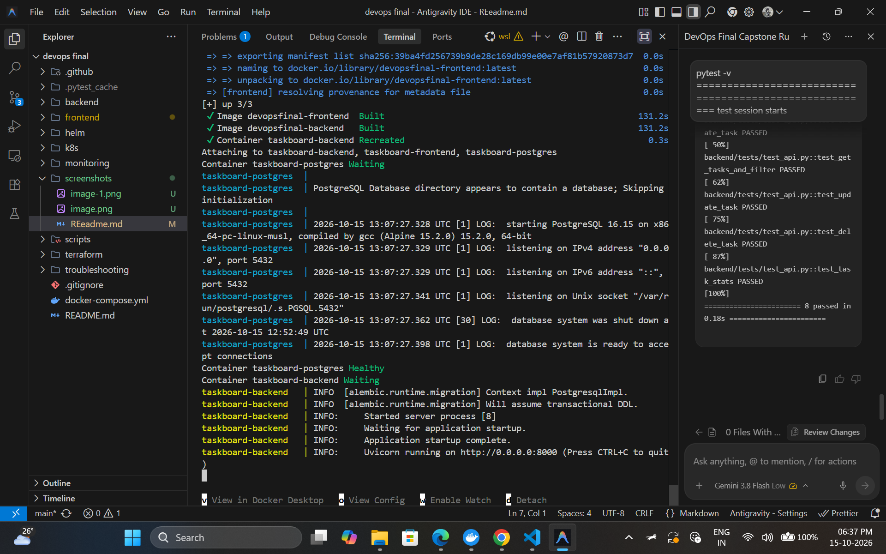

> **Application Loaded via Docker Stack:** Browser verification at `http://localhost:3000` connected to containerized backend and database.

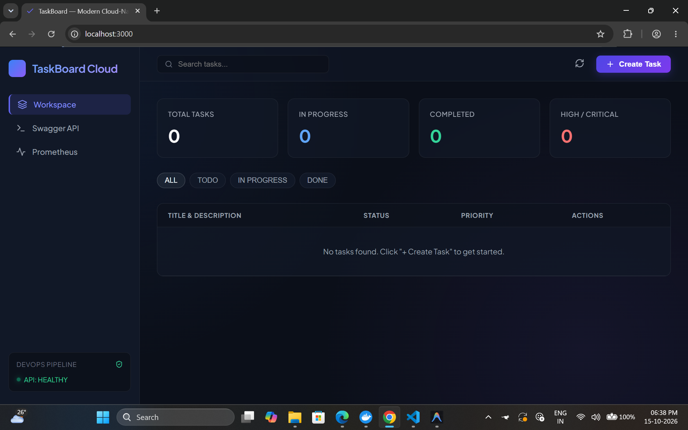

---

## Module 5: CI/CD — GitHub Actions Pipeline

### Architecture & Features:
- Automated GitHub Actions workflow located in `.github/workflows/ci-cd.yml`.
- Triggers on push and pull request to `main` branch.
- Automated quality gate: executes Pytest tests and fails pipeline on test failure.
- Frontend build job building production assets with Vite.
- Docker images built and published to GitHub Container Registry (GHCR) tagged with Git commit SHA (`${{ github.sha }}`).

### Visual Verification:
> **GitHub Actions Pipeline Run:** Execution graph showing successful green jobs for test, frontend build, containerization, and security scan.

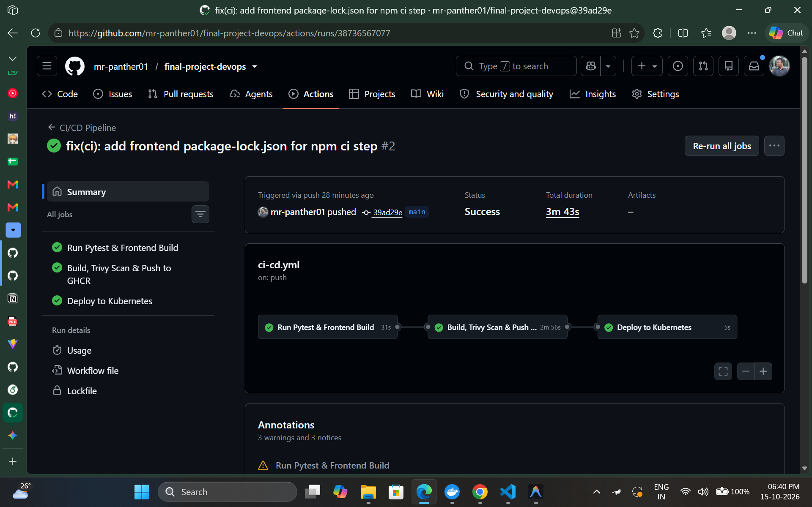

> **GitHub Container Registry (GHCR):** Published container packages showing immutable SHA-based image tags.

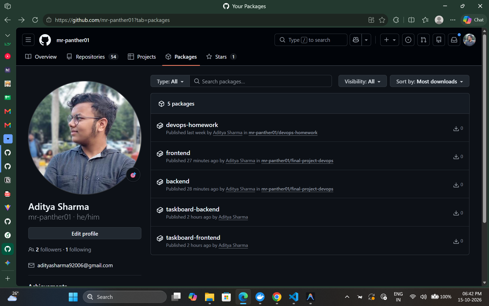

---

## Module 6: DevSecOps — Trivy Security Scan

### Architecture & Features:
- Automated container security scanning embedded in GitHub Actions pipeline.
- Scans both backend and frontend Docker images for OS and library vulnerabilities.
- Pipeline configured to fail on `HIGH` or `CRITICAL` severity CVEs (`exit-code: 1`).
- Clean scan explanation: Hardened minimal base images (`python:3.12-slim` and `nginxinc/nginx-unprivileged:alpine-slim`) minimize attack surface and reduce known CVE exposures.

### Visual Verification:
> **Trivy Vulnerability Scan Output:** Terminal report from GitHub Actions showing container scanning results and gate validation.

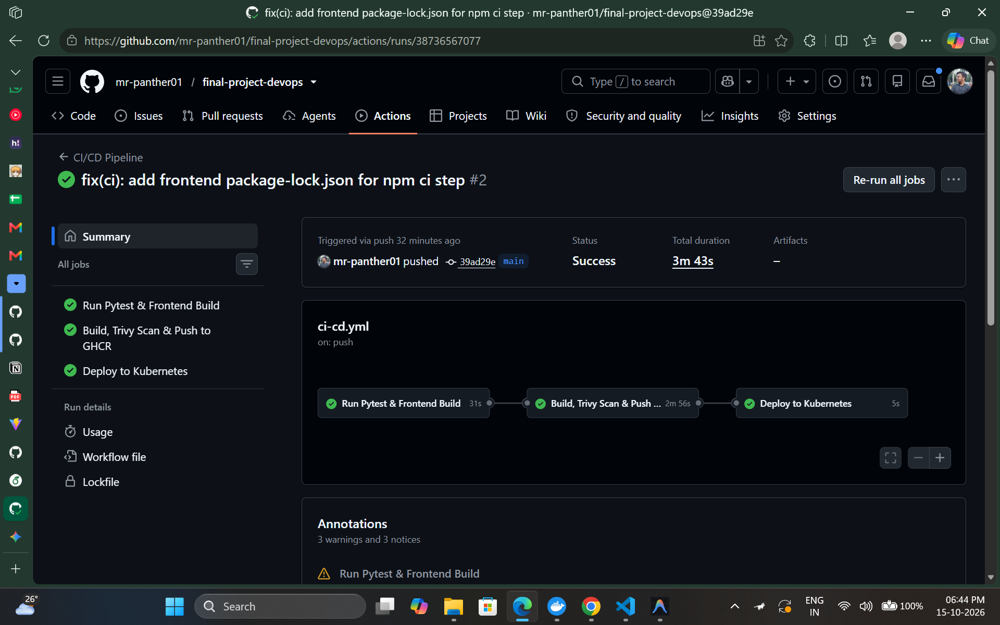

---

## Module 7: Terraform — AWS Infrastructure as Code

### Architecture & Features:
- Modular HCL code in `terraform/` directory (`vpc.tf`, `eks.tf`, `main.tf`, `variables.tf`, `outputs.tf`).
- `terraform.tfvars.example` provided with safe defaults (no committed credentials).
- AWS VPC provisioned with 2 public subnets, 2 private subnets, Internet Gateway, Elastic IP, and NAT Gateway.
- AWS EKS managed cluster (Kubernetes v1.31) with IAM roles and managed worker node group.
- Clean resource teardown verified via `terraform destroy`.

### Visual Verification:
> **Terraform Plan & Init Execution:** HCL validation and non-empty plan detailing 22 resources to be created.

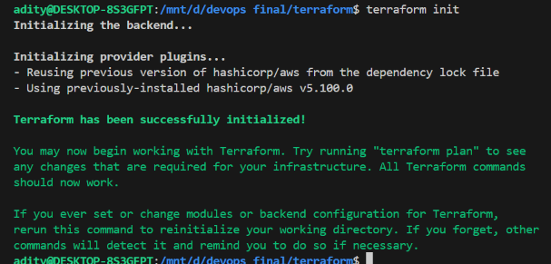

> **AWS VPC & Network Provisioning:** AWS Management Console displaying VPC, subnets across multiple availability zones, and NAT Gateway.

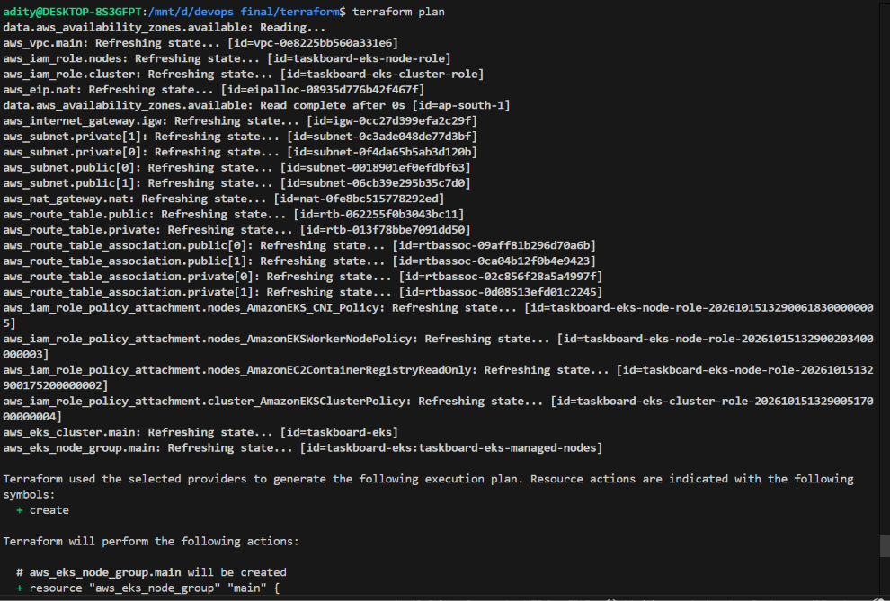
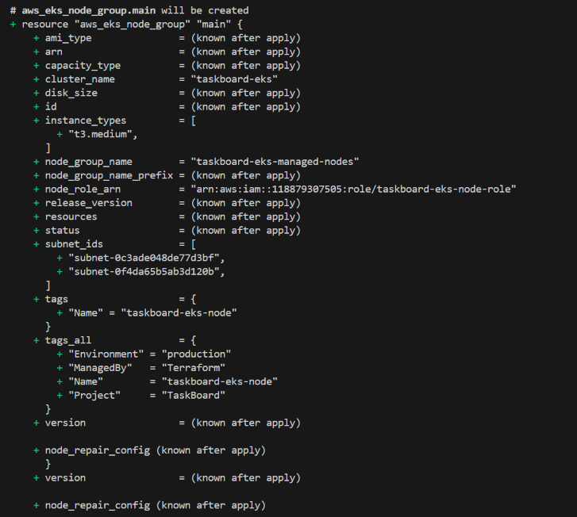
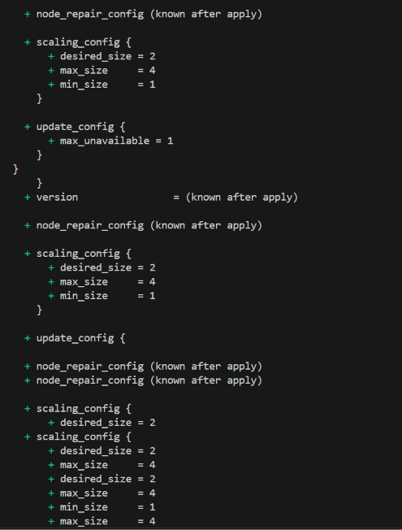

> **AWS EKS Cluster & Managed Nodes:** AWS EKS Console showing `taskboard-eks` cluster in `ACTIVE` state with healthy worker node group.

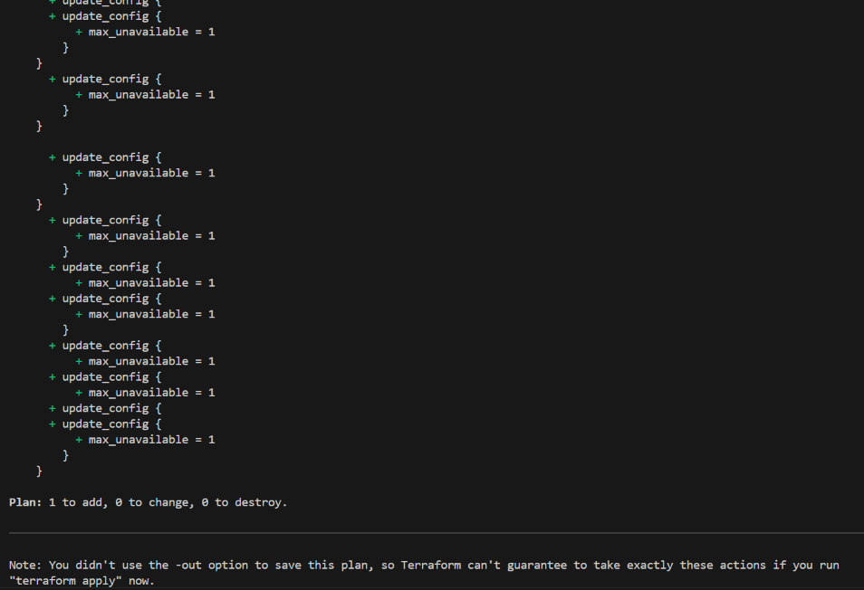
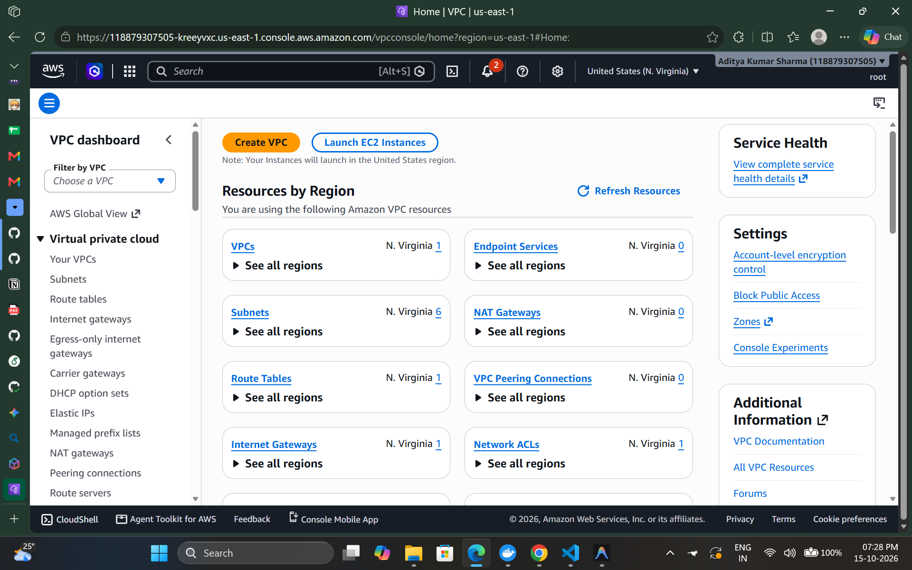
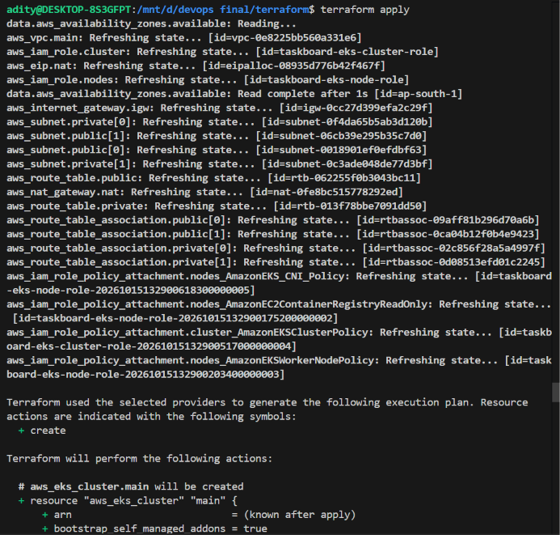
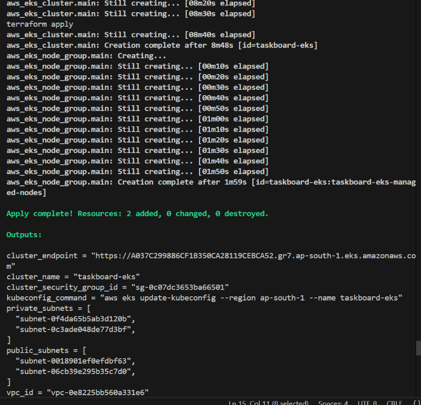
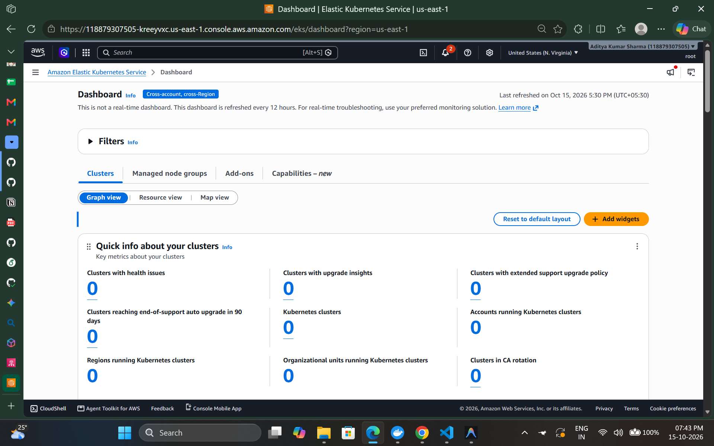

> **Terraform Destroy Verification:** Terminal output confirming clean teardown of all cloud resources to prevent runaway AWS costs.

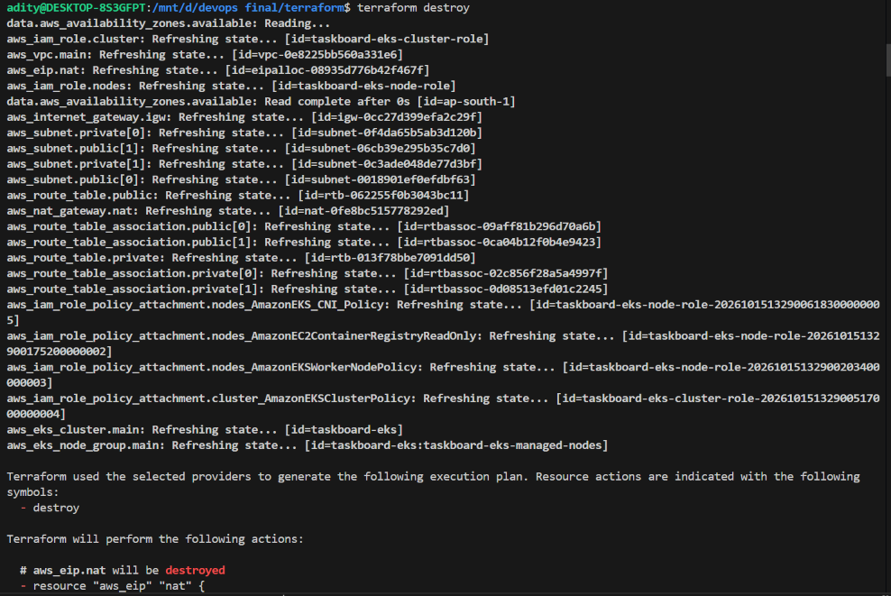
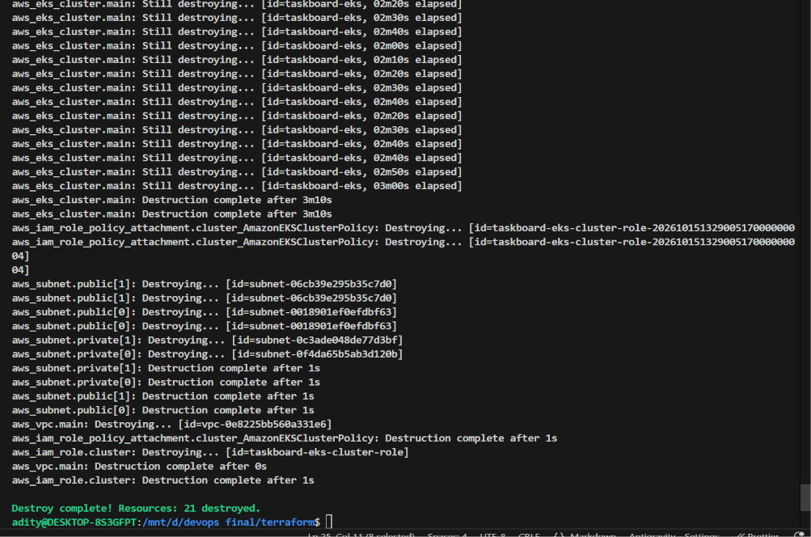

---

## Module 8: Kubernetes + Helm

### Architecture & Features:
- Dedicated namespace manifest in `k8s/namespace.yaml`.
- Production-grade Helm chart in `helm/taskboard/` (`Chart.yaml`, `values.yaml`, templates).
- Backend and frontend deployments configured with multiple replicas and resource requests/limits.
- ClusterIP services exposing frontend and backend.
- Kubernetes Ingress resource routing `/` to React frontend and `/api` to FastAPI backend.
- Horizontal Pod Autoscaler (HPA) configured for backend scaling.

### Visual Verification:
> **Kubernetes Cluster Workloads:** `kubectl get pods -n taskboard` showing all backend, frontend, and database pods in `Running` state alongside ClusterIP services.

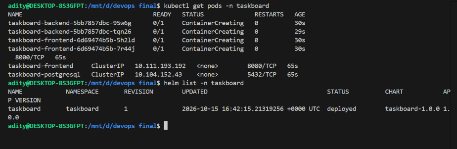

> **Helm Release & Ingress Access:** `helm list -n taskboard` confirming deployed release and browser accessing the application through Ingress / LoadBalancer routing.

---

## Module 9: Observability — Prometheus + Grafana

### Architecture & Features:
- Backend instrumented with `prometheus-fastapi-instrumentator` exposing machine-readable metrics at `/metrics`.
- Prometheus Operator `ServiceMonitor` configured in `helm/taskboard/templates/servicemonitor.yaml` to scrape application metrics.
- Prometheus installed and showing `taskboard-backend` target as `UP (1/1)`.
- Grafana installed with pre-configured dashboard displaying real-time HTTP request rate, p95 latency, and status code distribution.

### Visual Verification:
> **FastAPI /metrics Output:** Machine-readable Prometheus metrics format exposed directly by the backend service.

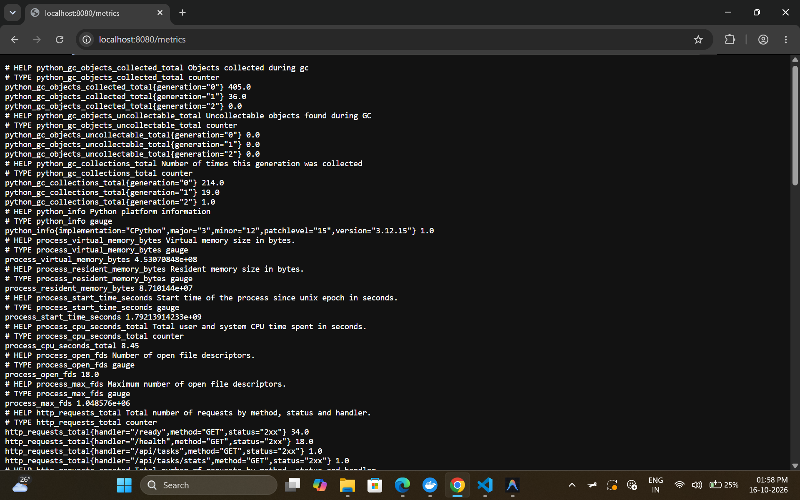

> **Prometheus Targets Health:** Prometheus Targets dashboard (`http://localhost:9090/targets`) displaying `serviceMonitor/taskboard/taskboard-backend/0` in green `UP` status.

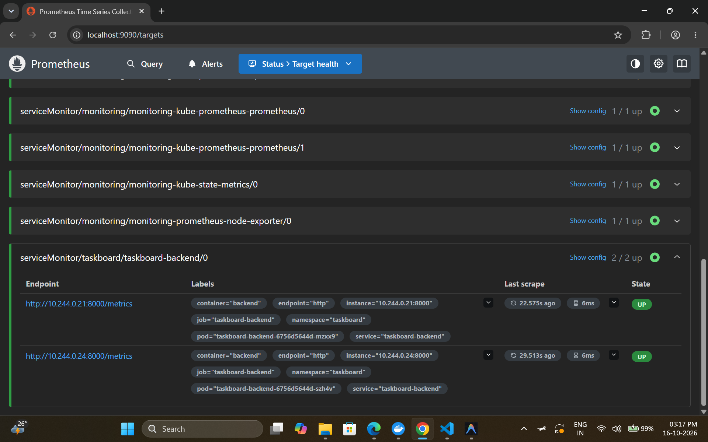

> **Grafana Observability Dashboard:** Live Grafana dashboard visualizing HTTP request rates, response times, and API health.

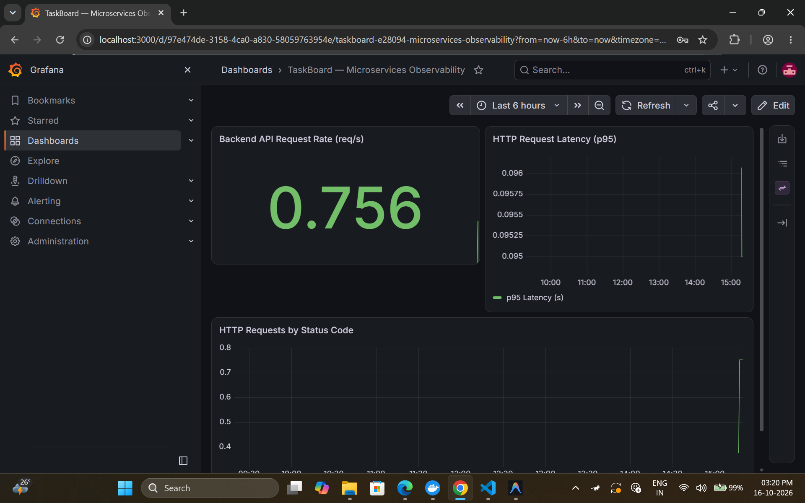

---

## Module 10: Documentation & Project Walkthrough

### Architecture & Features:
- Comprehensive root [`README.md`](../README.md) explaining application architecture, prerequisite setup, and step-by-step deployment.
- Live demonstration flow: code modification -> automated pipeline execution -> container scan -> Kubernetes deployment update.
- End-to-end cloud-native engineering lifecycle verified and documented.